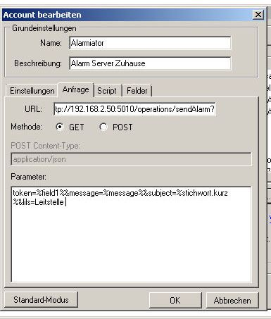
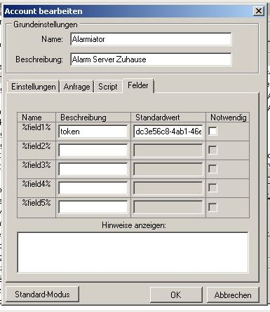

# Alarmierung mit BosMon

BosMon ist eininnovativesProgramm zum Dekodieren von **ZVEI**, **FMS**und **Pocsag**Telegrammen. BosMon übernimmt also die Dekodierung der Alarmierungsdaten von Funkmeldern und kann diese dann an ALARMiator weiterreichen. ALARMiator nutzt die eingehenden Alarmierungsdaten, legt eine Alarmierung an und verarbeitet sie dann nach den konfigurierten Regeln.


Allgemeine Informationen zu BosMon sind auf der offiziellen Website zu finden https://www.bosmon.de


Einrichtung API-Token


ALARMiator bietet eine sog. REST-API, die es Drittanwendungen erlaubt Alarmierungen auszulösen und Alarmierungsdetails zu übergeben. Um unberechtigten Zugriff und Fehlauslösungen zu unterbinden, benötigt jede Drittanwendung für den Zugriff auf die API ein sog. API-Token. API-Tokens sind eine lange Kette von Buchstaben und Zahlen. Ein Token für BosMon und andere Drittanwendungen kannst Du in der ALARMiator Verwaltungsoberfläche erstellen.


Melde Dich mit einem Benutzer mit Administrations-Berechtigung an der ALARMiator Oberfläche an. Navigiere zu **Admin → API-Token** und klicke auf **+ Neu**. Klappe den Menübereich auf und klicke auf "**neu anlegen**".


In dem nun dargestellten Formular vergibst Du eine sprechende **Beschreibung** für den Einsatzzweck des Tokens. Diese wird Dir zukünftig in allen Listen zur Identifizierung des API-Tokens angezeigt. Wähle als **Typ** **API Access** und speichere das Formular.


Nach dem speichern findest Du das neu erstelle Token in der Liste der API-Tokens. Über die Schaltfläche in der Zeile des Tokens kannst Du es kopieren, und zwar in die Zwischenablage Deines Browsers. des Tokens in die Zwischenablage Deines Browsers. Das Token benötigst Du für die folgende Konfiguration innerhalb BosMon.


## Einrichtung Datenübergabe


Damit BosMon eingehende Alarmierungen an ALARMiator weiterreichen kann, müssen ein paar Konfigurationen in BosMon vorgenommen werden. Details zu den sog. Push-Profilen in BosMon findest Du unter der folgenden URL: https://www.bosmon.de/doc/bosmon/1.5/howto/pushprofil.html


Richte nun in BosMon ein neues Push-Profil ein. Gebe dem Push-Profil einen Namen der die Verbindung zu ALARMiator erkennen lässt. Eine Beschreibung hilft Dir, später unterschiedliche Profile besser unterscheiden zu können.


Im Reiter Anfrage trägst Du in das Feld URL die Adresse für die REST API Deines ALARMiator Servers ein. Die URL der REST API entspricht dabei folgendem Aufbau:


```
http://name-oder-ip-deines-servers:Port/operations/sendAlarm?token=%field1%&message=%message%&subject=%stichwort.kurz%&ils=Leiststelle
```


#### name-oder-ip-deines-servers


trage hier den namen Deines Servers in Deinem Netzwerk ein oder die IP-Adresse. Achte bei Verwendung der IP-Adresse darauf, dass der Server von Deinem Router auch immer die gleiche IP-Adresse zugeteilt bekommt.


#### Port


Der Standardport für die REST API ist 5010. Wenn Du für die REST API einen anderen Port konfiguriert hast (Plugin-Einstellung REST API), dann musst Du hier den von Dir konfigurierten Port eintragen.


#### Pflichtfelder


Um eine Alarmierung über die REST-API auslösen zu können sind mindestens die beiden Felder "**token**" und "**subject**" zu übergeben. Alle anderen Felder sind optional. Du kannst in der URL Felder der Alarmierung fest belegen, in dem Du in der URL den Feldnamen und einen festen Wert übergibst, oder dynamische Felder in der URL konfigurierst (*%feldname%*). In unserem obigen Beispiel wird für das Feld **ils** immer fest der Wert "**Leitstelle**" übergeben.





Wähle als **Methode** **GET** aus, damit die Übergabe an die ALARMiator REST-API funktioniert.


Nun musst Du in BosMon noch die Verbindung zwischen den URL-Feldern und den in BosMon ermittelten Daten herstellen, sowie das Token eintragen:


