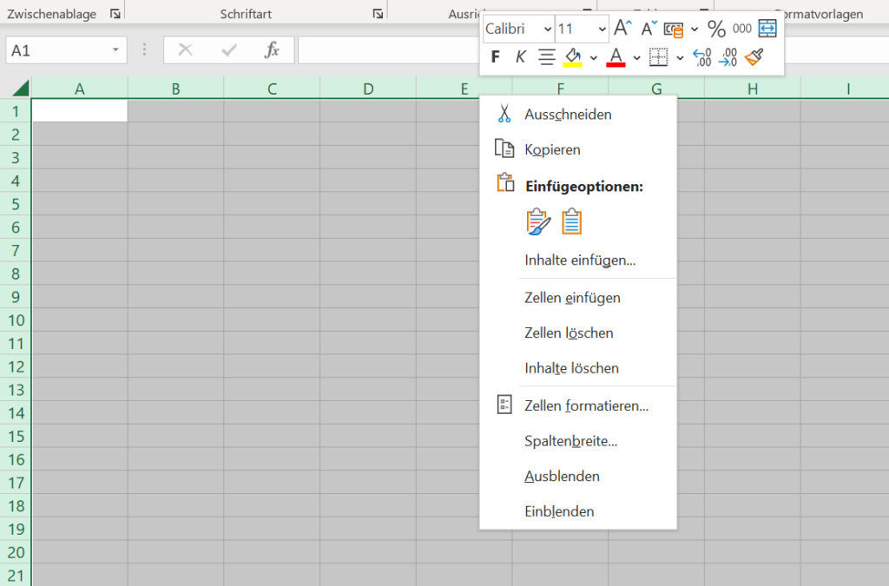
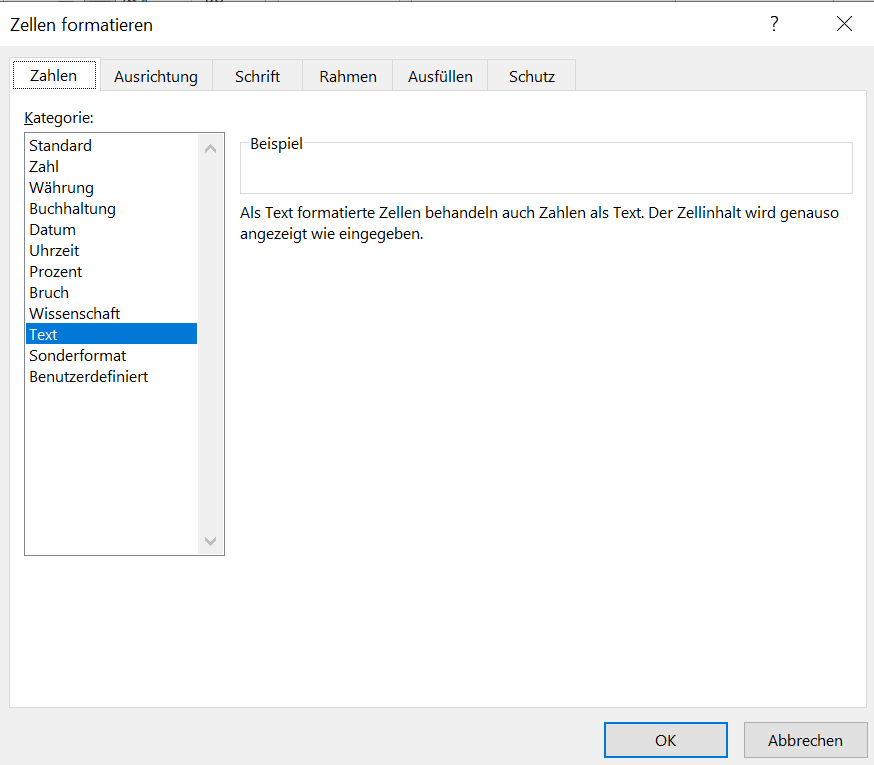
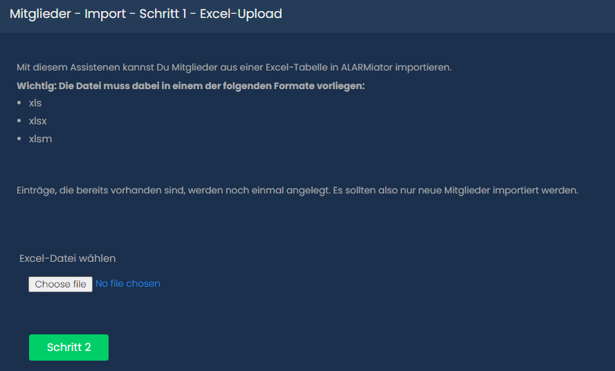
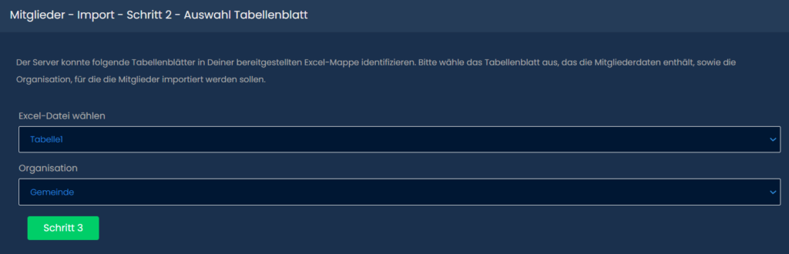
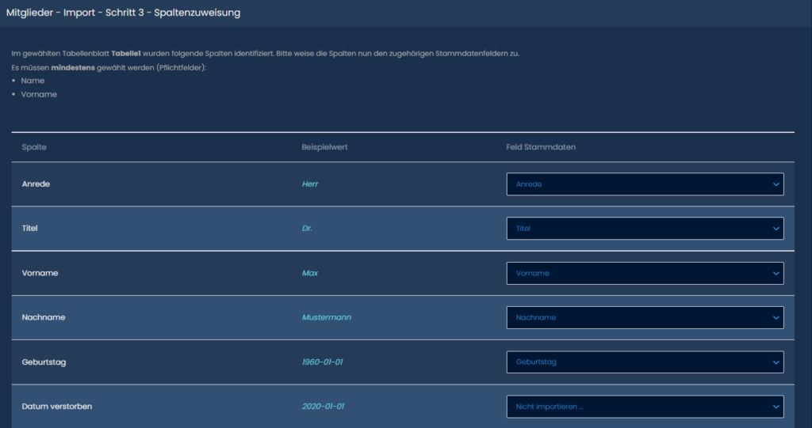

# Mitglieder anlegen

## Mitglied manuell anlegen

Navigiere zu **Stammdaten → Mitglieder** und klicke auf **+ Neu**.

Das Formular ist in sechs Schritte aufgeteilt. Über die Leiste oben kannst du zwischen ihnen wechseln.

Pflichtfelder sind mit einem roten Stern markiert. Hinterlege unter **Kommunikation** möglichst eine E-Mail-Adresse, sonst können dem Mitglied später keine Zugangsdaten geschickt werden.

Unter **Zuordnungen** vergibst du Gruppen, Rollen und Qualifikationen. Für die Alarmierung sind vor allem die Gruppen wichtig: Sie legen fest, welche Alarmierungen das Mitglied erhält. Wie man eine Gruppe anlegt, erfährst du unter [Gruppen anlegen](/docs/gruppen-anlegen).

Unter **Login** kannst du direkt einen Benutzer-Account anlegen. Lässt du den Benutzernamen leer, wird kein Login erstellt; das geht auch später unter [Benutzer anlegen](/docs/benutzer-anlegen).

Klicke auf **Speichern**. Dein neues Mitglied ist nun in der Mitgliederliste zu sehen.

## Mitglied bearbeiten

Klickst du in der Liste auf ein Mitglied, öffnet sich seine Detailseite. Mit dem Stift oben rechts kannst du Anpassungen vornehmen.

## Mitglieder über den Excel Import anlegen

:::caution Fehlt in der neuen Oberfläche
Der Excel-Import ist in der aktuellen neuen Oberfläche noch nicht enthalten. Die alte Oberfläche ist weiterhin unter `/oldui` erreichbar (sofern der Reverse Proxy die Route dorthin weiterleitet) und bietet den Import. Die Bilder in diesem Abschnitt zeigen die alte Oberfläche.
:::

### Importierbare Daten

Alle Datumfelder müssen im ISO-Format angegeben sein also: YYYY-MM-DD

* Anrede
* Titel
* Vorname
* Nachname
* Geburtstag
* Datum verstorben
* Straße
* Postleitzahl
* Stadt
* Bundesland
* Land
* Mitgliedsnummer
* DJF Nummer
* Datum Eintritt
* Datum Austritt
* Datum Eintritt Aktivendienst
* Datum Ausscheiden Aktivendienst
* Aktive Monate Fremdorganisation
* Telefonnummer
* Email-Addresse
* Mobiltelefonnummer
* Geschlecht

### Excel Liste anlegen

Alternativ kannst du hier auch eine Musterdatei herunterladen:

[ALARMiator-Mitgliederimport.xlsx](https://handbuch.alarmiator.de/wp-content/uploads/2022/02/ALARMiator-Mitgliederimport.xlsx)[Herunterladen](https://handbuch.alarmiator.de/wp-content/uploads/2022/02/ALARMiator-Mitgliederimport.xlsx)

Die zu importierende Excel List muss als einer dieser Formate gespeichert werden:

* xls
* xlsx
* xlsm

Vor dem Eintragen der Daten solltest du in Excel alle Spalten die du brauchst als "Textspalte" einstellen.

Drücke dazu "STRG + A". Es sollten alle Zellen markiert sein. Klicke nun Rechtsklick auf eine Spalte.

Du solltest nun folgendes sehen:

Klicke nun auf "Zellen formatieren ...".

Wähle Text aus und klicke OK. Nun sind alle Zellen Textzellen.

Nun kannst du in die Erste Zeile die gewünschten Headernamen eintragen und darunter die Daten deiner Mitglieder.

### Excel Liste hochladen und importieren

Navigiere zu **Stammdaten → Mitglieder** und klicke auf das Excel Sheet Symbol neben dem blauen + Symbol.

Es öffnet sich folgendes Fenster:

Lade hier deine Datei hoch und klicke auf Schritt 2.

Hier wählst du aus in welchem Sheet die Mitglieder stehen und zu welcher Organisation Sie gehören.

Klicke auf Schritt 3.

Hier kannst du Zuweisen welche Spalten in deiner Excel Datei, welchen zu importierenden Daten entsprechen.

Das wurde hier bereits beispielhaft gemacht. Solltest du eine Spalte nicht importieren wollen kannst du Sie auf "Nicht importieren" lassen. Zwingend importieren musst du nur Vorname und Nachname.

Bist du mit deinen Zuweisungen fertig Klickst du auf unten auf den grünen Button und deine Mitglieder werden importiert. Du siehst Sie nun in deiner Mitgliederliste.