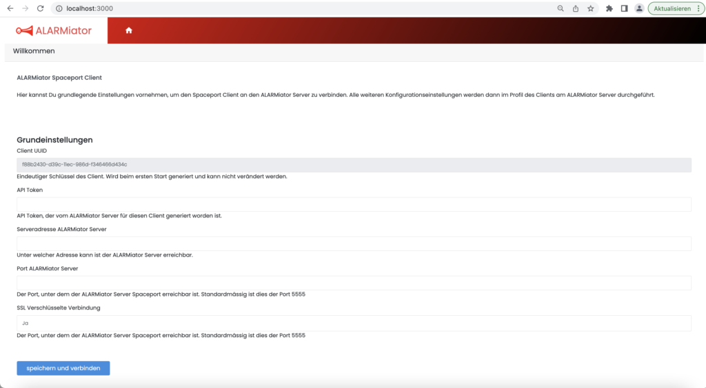
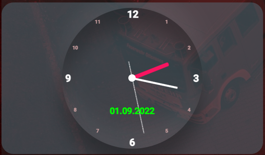

# Spaceport Client anlegen

## Client anlegen


Was du benötigst:


* Einen Raspberry Pi oder anderen Computer, den du als Spaceport betreiben willst.
* Ein vorinstalliertes Betriebssystem auf deinem Pi / PC. Am besten ein Linux (Raspberry Pi OS / Ubuntu Server)


Um den Spaceport zu installieren verbinde dich per ssh mit deinem Pi.


Lade dir nun das aktuellste Spaceport Release runter:


```
wget https://alarmiator.de/wp-content/uploads/2025/10/ALARMiator-Spaceport-2.0.2-stable.zip
```


```
unzip ALARMiator-Spaceport-2.0.2-stable.zip
```


1. [Aktualisieren der Systempakete](installation-des-servers-via-docker-compose)
2. [NodeJs Installieren](installation-des-servers-via-docker-compose)


Im Ordner mit den entzippten Dateien ein Terminal öffnen und folgende Befehle eingeben, um alle Abhängigkeiten zu installieren und den Client zu starten:


```
npm i
```


```
npm install uuid
```


```
sudo npm install -g pm2
```


```
pm2 start spclient_pm2.yml
```


```
pm2 startup
```


Lies dir die Konsolenausgabe nach pm2 startup durch und gebe gegebenenfalls den Befehl ein, welcher dort steht. Es wird ein etwas längerer Befehl sein, der den ALARMiator Service als festen Service anlegen wird.


Danach musst du diese Konfiguration noch speichern mit:


```
pm2 save
```


Als nächstes die Adresse **localhost:3000** aufrufen, um auf die Konfigurationsseite zu gelangen, die folgendermaßen aussieht:


* ***Localhost*** bezieht sich hierbei auf den Pi, auf dem der Spaceport läuft. Wenn du die Webseite von einem anderen PC aufrufen möchtest musst du dies über die Ip Addresse oder den Hostnamen deines Pi's machen.





## Daten eingeben


Die folgenden Daten sind nun einzugeben:


* API Token
* Serveradresse
* Port
* SSL Verschlüsselung aktivieren


### Port


Der Port ist von der Art der Verschlüsselung abhängig.


#### Gleiches Netz wie der Server


Wird der Spaceport im gleichen Netz wie der Server betrieben kann man die SSL Verschlüsselung deaktiviert lassen. Hier kann man nun **5555** als Port angeben (falls dies nicht schon automatisch passiert).


#### Externes Netz


Nutzt man den Spaceport Client in einem externen Netz, sollte man die SSL Verschlüsselung für eine höhere Sicherheit aktivieren. Es wird empfohlen den Server über den Proxy Manager zu betreiben wie das geht findest du in der Anleitung für die([ Installation des Servers](installation-des-servers-via-docker-compose)). Der Port hierfür ist **443**.


### API Token erstellen

Das Api Token kannst du auf dem ALARMiator Server erstellen. Logge dich also im Adminpanel ein.

Um ein API Token zu erstellen, navigiere zu **Admin → API-Token** und klicke auf **+ Neu**. Hier dann eine Beschreibung vergeben und als **Typ** **Spaceport Client** auswählen und **Speichern**.


Das neu erstellte Token dann auf der Konfigurationsseite des Spaceports eintragen.

### Client anlegen

Der Client muss auf dem ALARMiator Server angelegt werden. Navigiere zu **Admin → Spaceport-Clients** und klicke auf **+ Neu**. Hier den **Einsatzzweck** angeben, **Organisation** und **Standort** auswählen und speichern. Als **API-Token** kannst du das eben angelegte Token wählen. Lässt du das Feld leer, wird ein neues Token erzeugt.


In den weiteren Schritten stellst du Alarmgruppen, Drucker und MQTT ein. Die Clients siehst du anschließend in der Liste, die Druckaufträge unter **Admin → Spaceport-Druckaufträge**.


### Spaceport Plugin aktivieren


Damit sich dein Alarmiator Server mit dem Spaceport verbindet musst du im Adminbereich das Plugin "ALARMiator Spaceport" aktivieren.


Starte den ALARMiator Server nun neu.


Die Grundeinstellungen am Spaceport sollten am Ende in etwa so aussehen (natürlich mit den jeweils angepassten Daten).





Stimmen die Daten auf **Speichern und Verbinden** klicken.